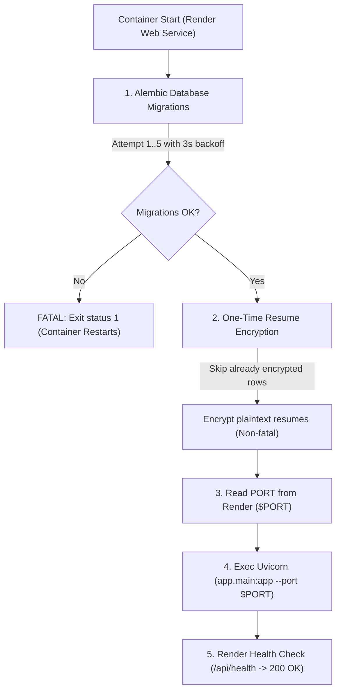

# PostCraft AI — Deployment Architecture & Operations Guide

> **Durable Reference Document**: This document outlines the architecture, environment variables, startup lifecycle, and platform-specific behaviors for PostCraft AI. Review this document before changing any dependency, secret, Dockerfile, or configuration file.

---

## 1. System Topology: Where Each Part Runs

PostCraft AI is designed around a **split-host platform-managed architecture** in production, with a decoupled backend and frontend:

```
                          ┌─────────────────────────────┐
                          │       Client Browser        │
                          └──────────────┬──────────────┘
                                         │
                 ┌───────────────────────┴───────────────────────┐
                 │                                               │
                 ▼ HTTPS                                         ▼ HTTPS
       ┌───────────────────┐                           ┌───────────────────┐
       │   Vercel Edge     │                           │   Render Cloud    │
       │ (Next.js Frontend)│                           │ (FastAPI Backend) │
       └───────────────────┘                           └─────────┬─────────┘
                                                                 │
                                                ┌────────────────┴────────────────┐
                                                ▼                                 ▼
                                     ┌─────────────────────┐           ┌─────────────────────┐
                                     │  Render PostgreSQL  │           │   Persistent Disk   │
                                     │ (Managed Database)  │           │  (/var/data Chroma) │
                                     └─────────────────────┘           └─────────────────────┘
```

### Hosting Breakdown

| Component | Hosting Platform | Runtime / Execution Model | Public URL / Exposure |
| :--- | :--- | :--- | :--- |
| **Frontend** | **Vercel** | Next.js 16 (Turbopack, Serverless/Edge) | `https://<project-name>.vercel.app` (Custom domain supported) |
| **Backend** | **Render** | Docker Container (`python:3.12-slim`) running `uvicorn` | `https://<service-name>.onrender.com` (TLS terminated by Render) |
| **Database** | **Render** | PostgreSQL (Managed Service, SSL required) | Private internal connection or external `postgres://...` |
| **Vector DB** | **Render Disk** | ChromaDB (local persistence on `/var/data`) | Local filesystem volume attached to the Render web service |

### How Frontend & Backend Communicate
1. The browser loads the Next.js static pages and scripts from **Vercel**.
2. When the user interacts with the app (Auth, Generation, History, Profile), the browser issues cross-origin `fetch()` requests directly to the **Render** backend URL specified by `NEXT_PUBLIC_API_URL`.
3. The Render backend inspects:
   - `ALLOWED_HOSTS`: Validates the Host header (`localhost`, `*.onrender.com`, or custom domain).
   - `CORS_ORIGINS`: Permits cross-origin requests from the Vercel origin.
   - `Authorization: Bearer <jwt>`: Validates user identity using `JWT_SECRET_KEY`.

---

## 2. The Two Deployment Paths

There are **two distinct deployment paths** in this repository. They serve different environments and use completely different configuration files:

```
                            Deployment Paths
                                   │
        ┌──────────────────────────┴──────────────────────────┐
        ▼                                                     ▼
[Path A: Platform-Managed]                             [Path B: Self-Hosted VM]
- Frontend: Vercel (Native)                            - Single Linux VPS (Hetzner, AWS EC2, etc.)
- Backend: Render Web Service                          - Multi-container stack (`docker-compose.prod.yml`)
- TLS: Render & Vercel Auto-SSL                        - TLS: Caddy reverse proxy (ports 80 & 443)
- Routing: Direct cross-origin                         - Routing: Caddy reverse proxies `/api/*` to backend
- Config: `render.yaml`, platform envs                 - Config: `.env`, `docker-compose.prod.yml`, `Caddyfile`
```

> [!IMPORTANT]
> **Changes to one path DO NOT apply to the other**:
> - If you edit `docker-compose.prod.yml` or `frontend/Caddyfile`, **Render and Vercel are completely unaffected**.
> - Do **not** apply Caddy-specific assumptions (like relative `/api` calls without a public URL, or internal `http://backend:8000` DNS names) to the Vercel/Render path.
> - In Next.js, `output: "standalone"` is **strictly reserved for Docker builds** (Path B). It must **never** be enabled when building on Vercel (Path A).

---

## 3. Environment Variable Reference Matrix

The table below lists every environment variable required across production services.

| Variable Name | Required By | Where Set | Purpose | Behavior if Missing / Malformed |
| :--- | :--- | :--- | :--- | :--- |
| `JWT_SECRET_KEY` | Backend | Render Dashboard | Signs & verifies HS256 auth tokens | **CRASHES AT STARTUP**: Fail-closed guard exits with status 1 if missing or <32 chars. |
| `RESUME_ENCRYPTION_KEY` | Backend | Render Dashboard | Fernet (AES-128-CBC + HMAC) key for encrypting resume PII at rest | **CRASHES ON RESUME ACTIONS**: Migration skips with warning; upload/view endpoints fail closed with status 1. |
| `DATABASE_URL` | Backend | Render Dashboard (Auto-bound from Postgres) | Connection string for PostgreSQL | **CRASHES AT STARTUP**: SQLAlchemy engine cannot connect; migrations fail. |
| `ALLOWED_HOSTS` | Backend | Render Dashboard | Trusted host whitelist for `TrustedHostMiddleware` | **HTTP 400 BAD REQUEST**: Returns 400 to any request with an unrecognized Host header. Defaults to `localhost,127.0.0.1,testserver,*.onrender.com`. |
| `CORS_ORIGINS` | Backend | Render Dashboard | Allowed origins for browser CORS preflights | **BROWSER CORS BLOCK**: Requests from Vercel fail in the browser console. |
| `GEMINI_API_KEY` | Backend | Render Dashboard | Google Gemini AI API key | **HTTP 500 / GENERATION FAILURE**: Pipeline nodes crash when calling the Gemini model. |
| `SERP_API_KEY` | Backend | Render Dashboard | SerpApi search key (fallback search) | Non-fatal: Research node falls back to Tavily or synthetic context. |
| `TAVILY_API_KEY` | Backend | Render Dashboard | Tavily search API key (primary search) | Non-fatal: Research node falls back to SerpApi or synthetic context. |
| `SENTRY_DSN` | Backend | Render Dashboard (Optional) | Sentry error tracking DSN | Non-fatal: Error reporting is disabled silently. |
| `ENVIRONMENT` | Backend | Render Dashboard | `production` vs `development` | Defaults to `development`. Controls CSP strictness and debug logging. |
| `DEBUG` | Backend | Render Dashboard | `False` in production | Defaults to `True`. Enables verbose query logging. |
| `NEXT_PUBLIC_API_URL` | Frontend | Vercel Dashboard | Public HTTPS URL of Render backend | **CLIENT FAILS**: Frontend fetches fallback to relative `/api` (hitting Vercel instead of Render) or `localhost:8000`. |

---

## 4. Backend Startup Lifecycle (`start.sh`)

When Render launches the backend container, it runs [`backend/start.sh`](file:///c:/Project/Ai%20post/backend/start.sh) as its container entrypoint (`CMD ["/app/start.sh"]`):



### Startup Steps in Detail

1. **Alembic Database Migrations (`alembic upgrade head`)**:
   - Automatically applies pending schema revisions up to `head`.
   - Incorporates a 5-attempt retry loop (3 seconds between attempts) to wait for database connection readiness on cold start.
   - **Fatal**: If all 5 attempts fail, the container exits with code 1.
2. **Resume Encryption Migration (`python -m app.core.migrate_resume_encryption`)**:
   - Scans `user_resumes` table for plaintext `raw_text` or `structured_summary`.
   - Encrypts plaintext rows using Fernet key `RESUME_ENCRYPTION_KEY`.
   - Safe to re-run: skips rows already starting with token prefix `gAAAAA`.
   - **Non-fatal**: Caught with `|| echo "WARNING..."` so a failure does not prevent FastAPI from booting.
3. **Port Binding & Uvicorn Launch**:
   - Render automatically injects the `$PORT` environment variable (e.g., `10000`).
   - `start.sh` extracts `PORT_TO_USE="${PORT:-8000}"` and executes:
     ```bash
     exec uvicorn app.main:app --host 0.0.0.0 --port "$PORT_TO_USE"
     ```
4. **Health Check Endpoint (`/api/health`)**:
   - Render pings `/api/health` every few seconds to verify the service is alive.
   - The endpoint returns `{"status": "healthy"}` instantly without touching the database, guaranteeing quick zero-downtime health approval.

---

## 5. "Before You Change X, Check Y" (Pre-Flight Tripwires)

Before committing changes to this repository, verify this checklist:

### If you add a new environment variable:
- [ ] **Check Render**: If the variable is required by the backend, add it to the Render Web Service Environment settings **before** pushing to `main`.
- [ ] **Check Vercel**: If the variable starts with `NEXT_PUBLIC_`, add it to Vercel's Environment Variables settings before deployment.
- [ ] **Check Fail-Closed Logic**: If the code uses `sys.exit(1)` or raises during import, ensure it provides an actionable error message and loads `dotenv.load_dotenv()` for local dev/testing.

### If you add a new Python dependency (`pyproject.toml`):
- [ ] **Check System Libraries**: If the library relies on C extensions or OS packages (like `pdfplumber` needing `poppler-utils` or `psycopg2` needing `libpq5`), verify that [`backend/Dockerfile`](file:///c:/Project/Ai%20post/backend/Dockerfile) installs them in both `builder` and `runner` stages via `apt-get`.
- [ ] **Check Lockfile**: Run `uv sync` to ensure the package resolves cleanly without dependency conflicts.

### If you modify `next.config.ts`:
- [ ] **Do NOT hardcode `output: "standalone"`**: Standalone output must only be enabled when `process.env.DOCKER_BUILD === "true"`. Vercel builds will fail with `ENOENT: next-server.js.nft.json` if standalone mode is active on Vercel.
- [ ] **Do NOT create `outputDirectory: ".next"` in `vercel.json`**: Vercel handles Next.js builds automatically.

### If you create a new Alembic migration:
- [ ] **Check Module Imports**: Never import `security.py` or auth functions inside `env.py` or migration scripts. Keep database migrations isolated from auth runtime secrets.
- [ ] **Run Heads Check**: Run `alembic heads` locally to ensure no branching revisions exist.

### If you change domains or URLs:
- [ ] **Update `ALLOWED_HOSTS`**: Ensure the new backend domain is allowed by Starlette's `TrustedHostMiddleware` (e.g. `*.onrender.com`).
- [ ] **Update `CORS_ORIGINS`**: Ensure the new frontend domain is whitelisted on Render so browser cross-origin calls succeed.

---

## 6. Rollback Procedures

If a deployment breaks in production, follow these rapid recovery steps:

### Instant Rollback on Render (Backend)
1. Go to **Render Dashboard** -> Select `PostCraft-AI` service.
2. Click **Deploys** in the left navigation.
3. Find the last known-working deployment (e.g. before the broken commit).
4. Click the **`...`** menu on the right of that deploy -> Select **Rollback to this deploy**.
5. Render immediately stops the failed container and redeploys the last successful Docker image without waiting for a re-build.

### Instant Rollback on Vercel (Frontend)
1. Go to **Vercel Dashboard** -> Select `post-craft-ai` project.
2. Click **Deployments** tab.
3. Locate the last successful deployment.
4. Click the **`...`** menu -> Click **Instant Rollback** (or **Promote to Production**).
5. Vercel routes traffic to the previous deployment instantaneously (zero build time).

### Emergency Git Rollback
If you need to revert via source control:
```bash
# Revert the offending commit
git revert <commit-hash>
git push origin main
```
Both Render and Vercel will auto-deploy the revert commit within 2-3 minutes.
