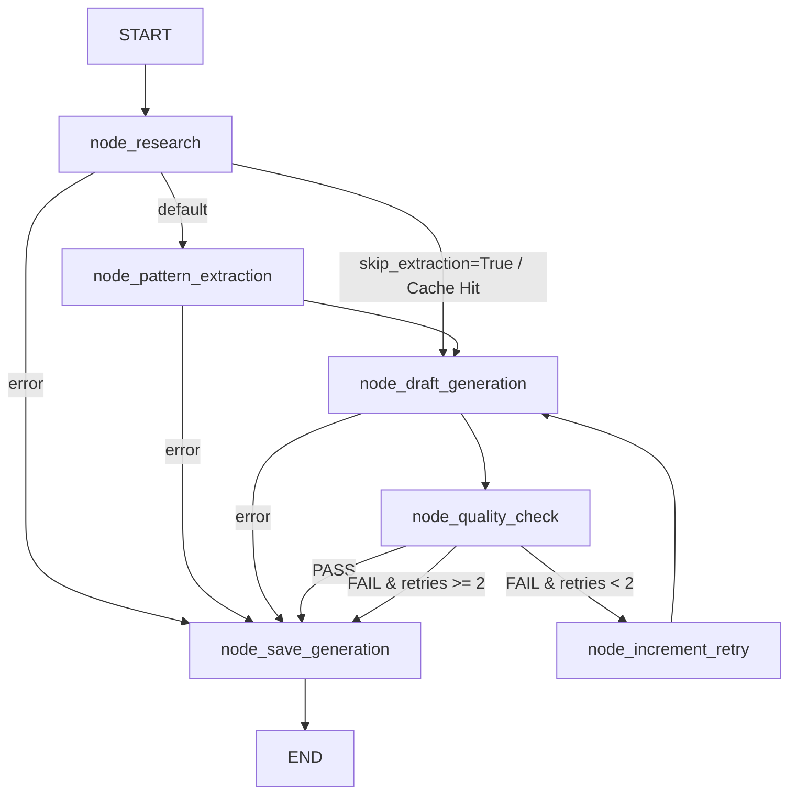

# PostCraft AI

An AI-powered content ghostwriting platform for LinkedIn and X (Twitter) built on **LangGraph** and **Google Gemini** (configurable via `GEMINI_MODEL`, e.g. `gemini-2.5-flash` or `gemini-3.5-flash-lite`).

PostCraft researches live public discussions on a topic, extracts high-leverage **writing patterns** (structure, tone, pacing, storytelling technique, formatting, CTA style), combines those patterns with the user's raw thoughts and **profile context**, and generates conversion-focused, high-engagement draft posts in ~10–15s locally (~21–23s on deployed cloud). Through a conversational editor and vector memory (ChromaDB), the system continuously adapts to the user's voice and business goals while enforcing strict quality gates (plagiarism detection, structural AI tell prevention, and unsourced number guards).

---

## Key Features

- **LangGraph State Machine & Sub-15s Generation**: Robust, typed workflow orchestration with targeted retry loops, asynchronous background database writes off the hot path, and model concurrency guards.
- **Strict Multi-Layer Quality Gates**:
  - **Gate 1 (Originality)**: 8-word n-gram / 10-word match against creator posts with common business idiom whitelist.
  - **Gate 1.5 (Structural AI Tells)**: Deterministic detection of cliché contrast syntax ("not X, it's Y") and triple parallel lists.
  - **Gate 1.6 (Unsourced Number Guard)**: Enforces that numbers and metrics come strictly from raw thoughts, resume context, or cited research.
  - **Gate 2 (Banned AI Vocabulary)**: Detects overused AI tropes.
  - **Gate 3 (Substance & CTA Evaluation)**: Calibrated 1–10 substance scoring with soft-miss routing to `needs_review`.
- **Targeted Retries**: Hard failures regenerate only the failing draft(s), preserving passing drafts and saving 15–30s of unnecessary LLM cycles.
- **Lead-Gen & Conversion-First CTAs**: Replaces generic engagement bait ("Thoughts?", "Agree?") with high-converting Call-to-Actions customized to the user's specific bio, role, or product.
- **Cascading Research Engine**: Multi-tiered search (DB Cache → Curated Top Creators → General Search → Synthetic Structure) with capped snippet sizes (1,500 chars) ensuring fast, context-rich grounding.
- **Vector Memory (ChromaDB)**: Learns and indexes your historical writing style to bias future generations toward your unique voice (with transparent fallback to PostgreSQL on ephemeral container filesystems).
- **Per-Draft Conversational Iteration**: Chat-based inline editor with isolated revisions per draft (`draft_index=1, 2, 3`). Chat contexts never bleed between drafts.
- **Finalized vs. Locked Enforcement**: When a post is finalized, only the selected draft displays **Finalized**; all other drafts are strictly marked as **Locked** across the editor, modal, history, and home views. The chosen draft is persisted in `Generation.active_draft_index`.
- **Interactive UI Polish & GSAP Motion**: Smooth cursor radial spotlight glow tracking, centered modal portal rendering, clean markdown parsing (no raw `**` asterisks), and theme-specific cadence glow.
- **Persona Engine & Resume Decoding**: Drag-and-drop resume upload (PDF/DOCX/text) with automated Gemini one-shot skill/role extraction, encrypted at rest via Fernet (AES-128-CBC + HMAC-SHA256), and persistent context injection into generation prompts.
- **Admin Control Center**: Dedicated `/admin` dashboard with cost analytics, live token metrics, user management, audit logging, and zero-shell `ADMIN_USERNAMES` promotion.
- **Concurrency & Rate-Limited Protection**: Global 4-slot concurrency semaphore with 10s queue wait timeout, daily 50-post per-user cap, and hourly endpoint rate limits.
- **Privacy & ToS**: Privacy Policy and Terms of Service rendered in-app; required agreement checkbox on sign-up; full GDPR disclosure.
- **Account Deletion**: Self-serve account deletion that cascades across PostgreSQL and ChromaDB — verified by typed username confirmation.

---

## Architecture & Pipeline Topology

PostCraft AI uses a compiled **LangGraph `StateGraph`** (`backend/app/services/pipeline/`) with explicit state transitions:



---

## Tech Stack

| Layer | Technology | Purpose |
|---|---|---|
| **Pipeline Framework** | LangGraph (>=1.2.0) | Stateful workflow orchestration & conditional routing |
| **LLM Integration** | langchain-google-genai (2.1+) | Structured LLM output & function calling with Gemini 2.5 Flash |
| **Backend** | FastAPI (Python 3.12) | High-performance asynchronous REST API |
| **Frontend** | Next.js 16 (React 19, TypeScript) | Modern UI with Tailwind CSS & shadcn/ui primitives |
| **Primary Database** | PostgreSQL 16 + SQLAlchemy (async) | Relational persistence & Alembic migrations |
| **Vector Database** | ChromaDB (0.5.23) | Vector embeddings for style learning & retrieval |
| **Web Research** | SerpApi / Tavily | Curated creator & live web research |
| **Reverse Proxy / TLS** | Caddy 2 | Automatic HTTPS via Let's Encrypt, reverse proxy |
| **Deployment** | Docker & Docker Compose | Containerized multi-stage builds |

---

## Local Development Setup

### Prerequisites

- [Docker](https://docs.docker.com/get-docker/) and Docker Compose
- [Node.js](https://nodejs.org/) 20+ and npm
- Python 3.12+ (or [uv](https://docs.astral.sh/uv/) for direct local backend development)

### 1. Configure Environment

```bash
cd backend
cp .env.example .env
# Required:
#   - GEMINI_API_KEY
#   - JWT_SECRET_KEY  (generate with: openssl rand -hex 32)
# Optional:
#   - SERP_API_KEY / TAVILY_API_KEY  (web research)
#   - RESUME_ENCRYPTION_KEY          (generate with: openssl rand -hex 32)
```

### 2. Start Services via Docker Compose (local)

```bash
# From project root
docker-compose up --build
```

This boots:
- **PostgreSQL** on port `5432`
- **ChromaDB** on port `8100` (mapped from 8000 internally)
- **FastAPI Backend** on port `8000`
- **Next.js Frontend** on port `3000`

### 3. Run Database Migrations

```bash
cd backend
$env:PYTHONPATH="."; .venv\Scripts\alembic upgrade head
# Or via uv / standard python
python -m alembic upgrade head
```

### 4. Run the Frontend

```bash
cd frontend
npm install
npm run dev
# Open http://localhost:3000
```

### 5. Health Checks

```bash
curl http://localhost:8000/api/health
# → {"status":"healthy","version":"0.1.0","environment":"development"}

curl http://localhost:8000/api/health/db
# → {"status":"connected"}
```

---

## Environment Variables

| Variable | Required | Description |
|---|---|---|
| `DATABASE_URL` | Yes | PostgreSQL connection string (`postgresql+asyncpg://...`) |
| `GEMINI_API_KEY` | Yes | Google Gemini API key (Gemini 2.5 Flash) |
| `JWT_SECRET_KEY` | Yes | JWT signing secret — **must be at least 32 chars**. Fail-closed at startup if missing or too short. Generate with `openssl rand -hex 32`. |
| `ADMIN_USERNAMES` | No | Comma-separated list of usernames automatically elevated to admin upon login or registration (e.g. `Shikhar-Admin`). Essential for managed hosting platforms without shell access. |
| `RESUME_ENCRYPTION_KEY` | No | Fernet (AES-128-CBC + HMAC) key for encrypting resume PII at rest. Generate with `openssl rand -hex 32`. If absent, encryption is skipped but a warning is logged. |
| `SERP_API_KEY` | No | SerpApi key for Google search research |
| `TAVILY_API_KEY` | No | Tavily search API key (fallback research) |
| `CHROMA_HOST` | No | ChromaDB host (default: `localhost` or `chromadb` in Docker) |
| `CHROMA_PORT` | No | ChromaDB port (default: `8000`) |
| `ENVIRONMENT` | No | `development` / `production` |
| `CORS_ORIGINS` | No | Allowed CORS origins (default: `["http://localhost:3000"]`) |
| `SENTRY_DSN` | No | Sentry error tracking DSN (activates error monitoring when set) |
| `POSTCRAFT_DOMAIN` | Prod | Domain for TLS cert issuance (e.g. `app.yourdomain.com`) |
| `POSTCRAFT_ADMIN_EMAIL` | Prod | Admin email for Let's Encrypt expiry notices |

---

## Rate Limits

All write endpoints are protected by per-user rate limits via `slowapi`:

| Endpoint | Limit |
|---|---|
| `POST /api/auth/login` | 5 requests / minute |
| `POST /api/auth/signup` | 3 requests / minute |
| `POST /api/generations` | 10 requests / hour |
| `POST /api/generations/{id}/edit` | 20 requests / hour |
| `POST /api/generations/{id}/finalize` | 30 requests / hour |

When a 429 is returned, the response includes a `Retry-After` header (seconds). The frontend surfaces this as a clear toast: *"Please wait N minutes and try again."*

---

## Security Model

- **JWT secrets**: Fail-closed at startup — the app refuses to start if `JWT_SECRET_KEY` is missing or under 32 characters.
- **Admin Access Control**: Dedicated `is_admin` boolean flag on users with zero-terminal bootstrap (`ADMIN_USERNAMES`), terminal CLI tool (`python -m app.cli.make_admin`), and audit logging for all admin actions.
- **Resume PII**: Encrypted at rest with Fernet (AES-128-CBC + HMAC-SHA256). Decryption fails-closed if the key is absent or corrupted.
- **DB TLS**: Production connections use `sslmode=require`.
- **Security headers**: CSP, `X-Content-Type-Options`, `X-Frame-Options`, `Referrer-Policy`, HSTS (1-year pin) applied via middleware.
- **Trusted Host**: `TrustedHostMiddleware` blocks Host-header attacks in production.
- **Account deletion**: Cascades via SQLAlchemy `cascade="all, delete-orphan"` across all user-owned rows in PostgreSQL and explicitly cleans ChromaDB vectors.
- **Sentry**: Wired in `main.py`, activates only when `SENTRY_DSN` is set. Does not send PII (drafts, resume text, chat history are excluded).
- **XSS sanitization**: All AI-generated draft content is sanitized via DOMPurify before rendering.
- **Caddy TLS**: Production uses Caddy 2 as a reverse proxy with automatic Let's Encrypt certificate issuance and renewal. Backend and frontend are not publicly exposed — only Caddy has public ports (80 + 443).

---

## Privacy & Legal

- **Privacy Policy** and **Terms of Service** are rendered in-app at `/privacy` and `/terms` views, accessible from the auth screen footer and the sidebar (logged-in).
- Sign-up requires an explicit "I agree to the Terms of Service and Privacy Policy" checkbox — the submit button is disabled until checked.
- **GDPR**: Additional disclosures for EU/UK users are included in the Terms view.
- See `PRIVACY.md` for the full legal document (last updated 2026-09-05).

---

## Running Tests

PostCraft AI includes a complete automated test suite verifying auth isolation, pipeline graph execution, quality checker logic, research cascading, resume encryption/extraction, and draft editing/finalization locking:

```bash
cd backend
$env:PYTHONPATH="."; pytest -v
# Or with uv / standard virtualenv:
PYTHONPATH=. pytest -v
```

**13 automated test cases passing**:
- `test_admin.py` (5 tests): Unauthenticated, non-admin forbidden, metrics, audit logging, `ADMIN_USERNAMES` auto-promotion.
- `test_auth.py` (1 test): Multi-user credential isolation.
- `test_editor.py` (1 test): Per-draft chat revision isolation (`draft_index`), persistence of `active_draft_index`, and post-finalization edit lock (HTTP 400).
- `test_pipeline_graph.py` (2 tests): Graph compilation and full execution.
- `test_quality_checker.py` (1 test): Plagiarism and originality evaluation.
- `test_research.py` (1 test): Cascading research cache miss and hit.
- `test_resume.py` (2 tests): Resume upload lifecycle, Fernet encryption, and format extraction (PDF, text).

---

## Cloud Deployment (Render & Vercel)

### Backend on Render
1. Create a **Web Service** pointing to the repository root with root directory `backend`.
2. Environment: **Python 3**.
3. Build Command: `uv pip install -r pyproject.toml` (or standard `pip install -e .`).
4. Start Command: `./start.sh` (executes Alembic database migrations and resume encryption checks before starting Uvicorn on `$PORT`).
5. Provision a **Supabase PostgreSQL** instance (Permanent Free Tier). Copy the **Supavisor Session Pooler** URI (port 5432 for IPv4 compatibility) and supply DATABASE_URL formatted as postgresql+asyncpg://postgres.<project-ref>:<password>@aws-0-<region>.pooler.supabase.com:5432/postgres. Alembic auto-creates all tables on deploy via start.sh.
6. Set required environment variables: `GEMINI_API_KEY`, `JWT_SECRET_KEY`, `RESUME_ENCRYPTION_KEY`, `ADMIN_USERNAMES`, `ENVIRONMENT=production`.

### Frontend on Vercel
1. Create a new Vercel project pointing to the repository with root directory `frontend`.
2. Framework Preset: **Next.js**.
3. Build Command: `npm run build`.
4. Environment Variables:
   - `NEXT_PUBLIC_API_URL`: Your deployed Render backend URL (e.g. `https://api.postcraft.example.com` or `https://postcraft-backend.onrender.com`).
5. Output Directory: `.next`.

---

## Repository Structure

```
postcraft-ai/
├── docker-compose.yml              # Local development orchestration
├── docker-compose.prod.yml         # Production container definition (Caddy TLS, no public ports)
├── README.md                      # This file
├── PRIVACY.md                     # Privacy Policy, ToS, GDPR notes
├── POLISH_CHANGELOG.md            # GSAP animation and motion design changelog
├── DEPLOYMENT.md                  # Pre-launch checklist & security scorecard
├── DEPLOYMENT_ARCHITECTURE.md     # Production split-host architecture & operations guide
├── PostCraft_AI_Complete_Documentation.md  # Deep technical architecture reference
├── PROJECT_MASTERY_GUIDE.md       # Engineering teaching guide
│
├── backend/
│   ├── pyproject.toml
│   ├── Dockerfile                 # Multi-stage production build
│   ├── start.sh                  # Runs alembic migrations + encryption check + uvicorn
│   ├── alembic/                  # DB migrations
│   │   └── versions/             # Individual migration files (including 9c3e6b8d4f2a)
│   ├── creators/                 # Curated top creator lists (LinkedIn, X)
│   ├── tests/                    # Automated pytest suite
│   │   ├── conftest.py
│   │   ├── test_admin.py
│   │   ├── test_auth.py
│   │   ├── test_editor.py        # Draft chat isolation & finalization locking
│   │   ├── test_pipeline_graph.py
│   │   ├── test_quality_checker.py
│   │   ├── test_research.py
│   │   └── test_resume.py
│   ├── app/
│   │   ├── main.py              # FastAPI entrypoint, Sentry, security headers, middleware
│   │   ├── models.py            # SQLAlchemy models (User, Generation, StyleProfile, UserResume, CostLog, etc.)
│   │   ├── cli/
│   │   │   └── make_admin.py    # CLI tool to promote users to admin
│   │   ├── core/
│   │   │   ├── config.py        # Pydantic Settings (env vars, ADMIN_USERNAMES, JWT fail-closed)
│   │   │   ├── database.py      # Async SQLAlchemy engine & session factory
│   │   │   ├── security.py      # Argon2 password hashing & JWT (fail-closed)
│   │   │   ├── crypto.py        # Fernet resume encryption (fail-closed)
│   │   │   └── migrate_resume_encryption.py  # One-time plaintext→encrypted migration
│   │   ├── api/
│   │   │   ├── auth.py          # POST /api/auth/signup, /api/auth/login + auto-admin promotion
│   │   │   ├── users.py         # GET/PATCH/DELETE /api/users/me, resume upload/get/delete
│   │   │   ├── generations.py    # POST /api/generations (rate-limited)
│   │   │   ├── editor.py        # POST /api/generations/{id}/edit, /finalize (rate-limited)
│   │   │   ├── admin.py         # GET /api/admin/metrics, /users, PATCH /users/{id}/admin, /audit-logs
│   │   │   └── health.py        # GET /api/health, /api/health/db
│   │   ├── schemas/
│   │   │   ├── api.py
│   │   │   ├── editor.py
│   │   │   └── research.py
│   │   └── services/
│   │       ├── research.py      # 4-tier cascading search engine
│   │       ├── vector.py        # ChromaDB vector ops (+ delete_all_for_user)
│   │       ├── resume.py        # Resume text extraction (PDF/DOCX/TXT) + Gemini summarization
│   │       └── pipeline/       # LangGraph Post Generation Pipeline
│   │           ├── deps.py
│   │           ├── state.py
│   │           ├── prompts.py
│   │           ├── nodes.py
│   │           ├── graph.py
│   │           └── pipeline.py
│
└── frontend/
    ├── package.json
    ├── Dockerfile
    ├── Caddyfile               # Caddy reverse proxy config (TLS termination)
    ├── next.config.ts
    ├── tailwind.config.ts
    └── src/
        ├── app/
        │   ├── layout.tsx       # Root layout with theme provider
        │   ├── page.tsx         # Main workspace (view dispatcher: home/editor/profile/history/privacy/terms)
        │   ├── admin/
        │   │   └── page.tsx     # Admin Control Center (metrics, user table, audit logs)
        │   └── globals.css      # Design tokens (violet/magenta light, red/amber dark)
        ├── components/
        │   ├── layout/
        │   │   ├── app-shell.tsx   # Full sidebar + header wrapper
        │   │   ├── sidebar.tsx     # Nav, theme toggle, user row, admin link, legal footer links
        │   │   └── top-header.tsx  # Page title header
        │   ├── ui/               # Tailored UI components (Button, Card, Dialog, Input, etc.)
        │   └── theme-provider.tsx
        ├── features/
        │   ├── auth/            # AuthScreen, useAuth hook
        │   ├── generation/      # GenerationForm
        │   ├── editor/          # DraftEditor, DraftSelectionGrid
        │   ├── home/            # HomeView (greeting, quick capture)
        │   ├── history/         # HistoryList, DraftPreviewModal
        │   ├── profile/         # ProfilePage (Persona Engine + Drag-and-drop Resume + Danger Zone)
        │   └── legal/           # LegalView (Privacy Policy / ToS / GDPR via react-markdown)
        └── lib/
            ├── utils/
            │   └── markdown.ts  # Markdown rendering and text sanitization (DOMPurify)
            └── api/
                ├── client.ts    # Central fetch client (429 handling, 401 → auth-expired)
                ├── auth.ts
                ├── admin.ts     # getAdminMetrics, getAdminUsers, toggleUserAdmin, getAdminAuditLogs
                ├── user.ts      # getCurrentUser, updateCurrentUser, deleteMyAccount
                ├── resume.ts    # uploadResume, getResume, deleteResume
                ├── style-profile.ts
                ├── history.ts
                └── generation.ts
```

---

## License

Proprietary — All rights reserved.
