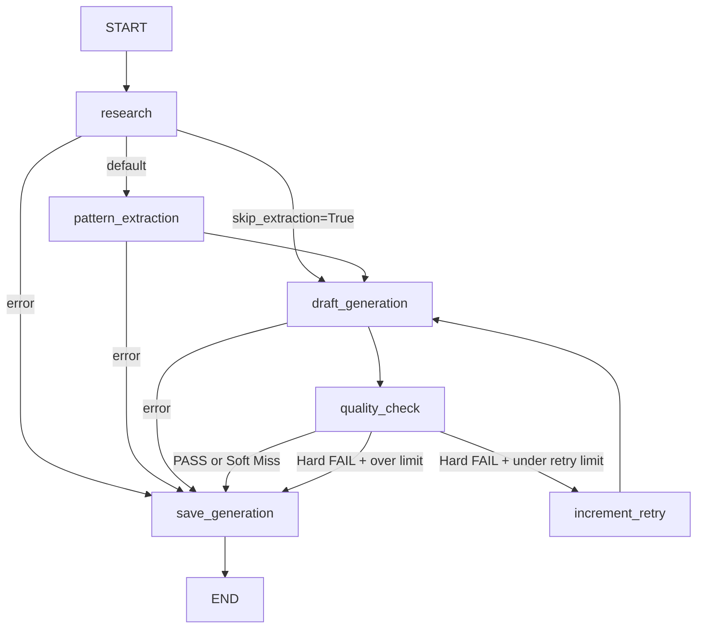

# PostCraft AI — LangGraph Generation Pipeline

This package handles the core AI post generation workflow. It is built using **LangGraph** to model the generation process as a state machine.

## How to learn LangGraph from this codebase

If you are learning LangGraph, this package is designed as a practical tutorial. 
Start by reading `graph.py` — it contains a module-level docstring that points out exactly where the 4 key LangGraph concepts (State, Nodes, Edges, Compiled Graph) are used.

## Architecture & File Structure

This module is split into focused files to make dependencies explicit and testing easier:

- `pipeline.py`: The public entry point. Exposes `PostGenerationPipeline`, which initializes dependencies and triggers the graph.
- `graph.py`: Defines the **topology** of the pipeline. What node runs after what, under what conditions. Includes targeted retry routing.
- `nodes.py`: The actual **work** of the pipeline. Each function takes the graph state, performs an action (like calling an LLM), and returns state updates.
- `prompts.py`: All LLM prompt templates and rules (e.g. lead-gen rules, engagement rules).
- `originality.py`: Originality engine comparing drafts against creator snippets using 8-word n-grams (2-hit threshold), 10-word consecutive matches, business idiom whitelisting, and site chrome filtering.
- `structural_checks.py`: Deterministic checks for structural AI tells ("not X, it's Y", triple parallel "Zero X means zero Y" lists, em-dash density).
- `unsourced_numbers.py`: Deterministic check ensuring figures and metrics in drafts originate from user raw thoughts, resume, or cited research (Gate 1.6).
- `background_tasks.py`: Asynchronous task execution for style profile indexing, cost logging, and research cache writes using isolated database sessions off the generation hot path.
- `state.py`: Defines `GraphState` (the internal dict that flows through the graph) and Pydantic schemas for structured LLM outputs.
- `deps.py`: Dependency injection container (`PipelineDeps`). Passed to every node to avoid global variables and closures.

## Quality Gates & Targeted Retry Workflow

The quality check stage executes a layered battery of deterministic and LLM evaluations:
1. **Gate 1 (Originality)**: 8-word n-gram / 10-word match against creator posts. (Hard failure)
2. **Gate 1.5 (Structural AI Tells)**: Deterministic detection of cliché contrast syntax and list tropes. (Hard failure)
3. **Gate 1.6 (Unsourced Metrics)**: Deterministic audit ensuring numbers originate from source material. (Hard failure)
4. **Gate 2 (Banned AI Vocabulary)**: Detects banned words ("testament", "delve", "tapestry"). (Hard failure)
5. **Gate 3 (Substance & CTA Evaluation)**: LLM substance score (1–10) and lead-gen CTA alignment. (Scores 4–6 or weak CTAs route as soft misses to `needs_review`)

### Targeted Retry Policy:
- When hard failures occur, `failed_draft_indices` isolates only the failing draft(s) (e.g., draft 2). Draft 1 and Draft 3 are preserved, and only Draft 2 is regenerated on retry.
- Soft misses (substance score 4–6, generic question CTA) bypass retry loops and proceed directly to save with status `needs_review`, preventing latency stalls.

## Graph Topology

